# NCICT 4

_**NCI Dosimetry System for Computed Tomography**_

Documented version: **4.20261014**
Update: **October 14, 2026 — Scientific Update**

This manual describes the local update under review, ahead of distribution.

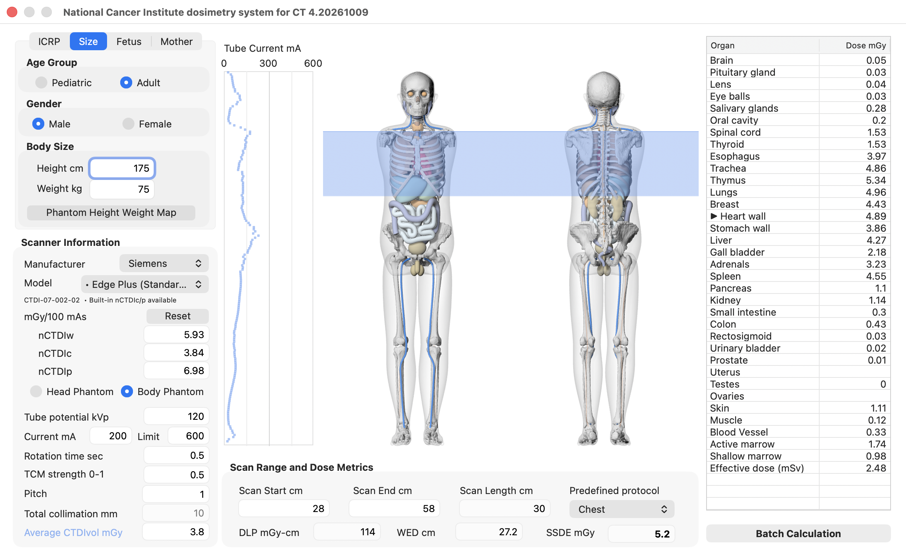

---

## Introduction

The **National Cancer Institute Dosimetry System for Computed Tomography (NCICT)** is a **reference-grade radiation dose estimation system** developed by the National Cancer Institute (NCI) for estimating organ absorbed doses and effective dose from computed tomography (CT) examinations.

NCICT is based on precalculated organ dose conversion coefficients derived from **Monte Carlo radiation transport simulations**, multiple **computational human phantom models**, and a **reference CT scanner framework**. The system supports **patient-specific dose calculations, population-based dose evaluation, and benchmarking**. It is not intended for clinical decision support.

The October 14, 2026 scientific update adds scanner-specific radial CTDI
correction, cephalic/breech fetal presentation support, an expanded `nCTDIw`
and `nCTDIc`/`nCTDIp` library, Monte Carlo uncertainty reporting, and corrected
muscle and blood-vessel dose coefficients.

---

## Calculation workflow

| Step | Description                                                  |
| ---- | ------------------------------------------------------------ |
| 1    | Define patient characteristics                               |
| 2    | Enter scanner parameters                                     |
| 3    | Define scan coverage                                         |
| 4    | Review organ and effective dose output                       |
| 5    | Optionally run multiple cases using Batch Calculation        |

Numeric fields accept either dot or comma decimal notation regardless of the
operating-system regional setting.

---

## 1. Patient characteristics

NCICT includes three phantom libraries to support matching of patient anatomy and body dimensions:

- ICRP reference pediatric and adult phantoms (n=12)
- Body size-dependent pediatric and adult phantoms (n=362)
- Pregnant women and fetal phantoms at 8, 10, 15, 20, 25, 30, 35, and 38 weeks of gestation

### 1.1 Age-based selection: ICRP reference phantoms

When detailed body size information is unavailable, users may select one of the **ICRP-defined reference age and sex groups**:

- 0-year (newborn) male or female
- 1, 5, 10, or 15 years (male or female)
- Adult male or female (assumed ≥20 years)

When ICRP phantoms are selected, reference height and weight are automatically assigned.

The ICRP reference height and weight pairs used by NCICT are:

| Reference phantom      | Height (cm) | Weight (kg) |
| ---------------------- | ----------- | ----------- |
| Newborn female or male | 47          | 4           |
| 1-year female or male  | 76          | 10          |
| 5-year female or male  | 110         | 19          |
| 10-year female or male | 140         | 32          |
| 15-year female         | 161         | 53          |
| 15-year male           | 166         | 56          |
| Adult female           | 168         | 60          |
| Adult male             | 178         | 73          |

If a patient's age falls between reference groups, users may perform external dose interpolation or select the nearest reference age group.

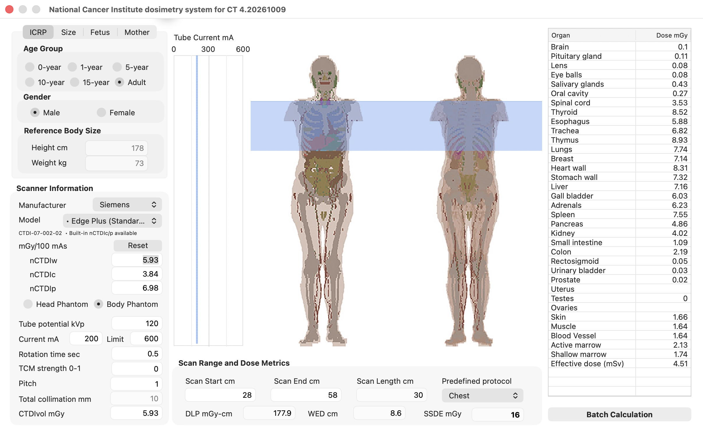

### 1.2 Height- and weight-based selection: size-dependent phantom library

When patient height and weight are available, users may specify body size directly within the pediatric or adult phantom libraries. This approach maps the patient's body size to the closest matching size-dependent phantom. Phantom height and weight can be adjusted using the up/down arrow keys.

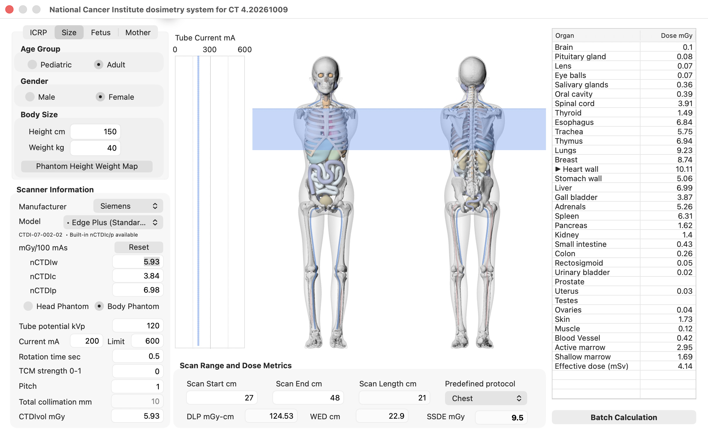

Alternatively, users can click the **"Phantom Height Weight Map"** button to access an interactive size map. Blue cells represent available height/weight combinations, and the selected cell is outlined; clicking a cell updates the selection in the main panel.

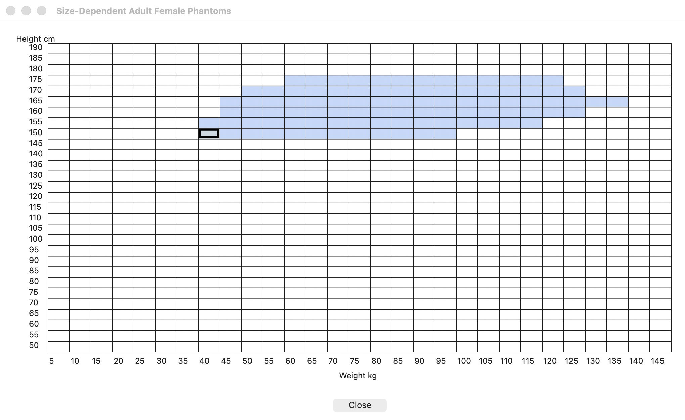

### 1.3 Fetus tab

When fetal organ doses are of interest, users can select the **"Fetus"** tab and specify gestational age (8–38 weeks). Fetal anatomy is shown in color, while maternal anatomy is grayed out in the phantom display. The GUI lists the corresponding **mother's perimeter (cm)** next to each gestational age to help select the most appropriate pregnancy phantom. The grouped **Cephalic** and **Breech** radio buttons select fetal presentation; **Breech** is available at 10, 15, 20, and 25 weeks. On this tab, the first column of the organ-dose output table is labeled **Fetal Organ**.

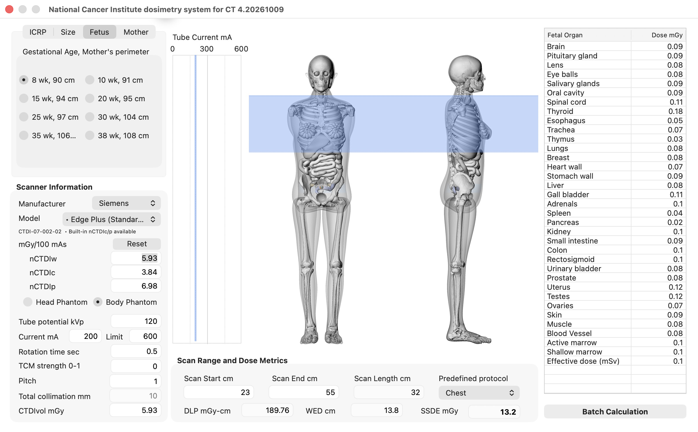

### 1.4 Mother tab

When maternal organ doses are of interest, gestational age and the corresponding **mother's perimeter (cm)** can be selected under the **"Mother"** tab. Maternal anatomy is shown in color, while fetal anatomy is grayed out in the phantom display. On this tab, the first column of the organ-dose output table is labeled **Maternal Organ**.

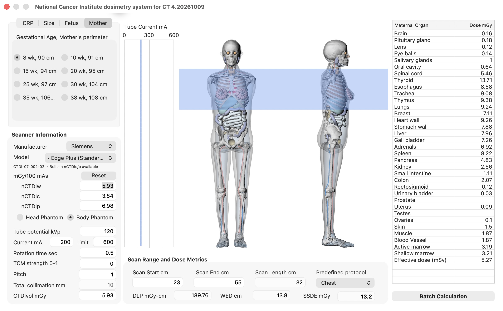

---

## 2. Scanner parameters

Two scanner parameter scenarios are supported.

### 2.1 CTDIvol unavailable

When CTDIvol is not available, it can be reconstructed from the scanner model, tube potential (kVp), tube current (mA), rotation time (sec), pitch, and total collimation (mm). CTDIvol (mGy) is automatically calculated using a built-in normalized CTDIw library in mGy/100 mAs for 160 selectable scanner/filter profiles. This profile count is not a count of unique scanner models because one scanner can have multiple filter conditions. Additional conditions are being added to the library through CTDI surveys.

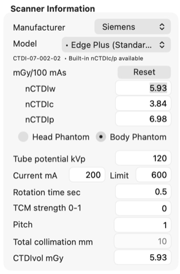

#### Center and peripheral CTDI controls

The **Scanner Information** panel displays normalized weighted CTDI (`nCTDIw`),
center CTDI (`nCTDIc`), and peripheral CTDI (`nCTDIp`) in mGy/100 mAs, where
`nCTDIw = (nCTDIc + 2 × nCTDIp) / 3`. When component values are available for
the selected scanner/filter, kVp, and CTDI phantom, NCICT loads them
automatically. A `•` before the scanner name indicates built-in c/p values, and
the line below the controls shows the CTDI profile ID and availability.

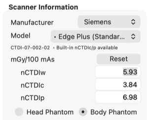

For example, `CTDI-07-002-02  • Built-in nCTDIc/p available` means:

- `CTDI-MM-SSS-FF` is the permanent profile-ID format. `MM` identifies the
  manufacturer, `SSS` the scanner, and `FF` the filter (`00` means no filter).
- In the shown example, `07-002-02` maps to Siemens, Edge Plus, Standard in the
  current registry.
- The ID identifies the selected scanner/filter condition; it is not a dose
  value.
- `• Built-in nCTDIc/p available` means that center and peripheral values are
  available for the selected kVp and CTDI phantom and are loaded automatically.
- If the availability text is absent, the profile does not provide a matching
  built-in pair. NCICT uses the conventional CTDIvol-only result unless the
  user supplies a validated custom pair.

Users may edit `nCTDIc` or `nCTDIp`. NCICT keeps `nCTDIw` fixed and updates the
other component automatically. Pressing **Enter** recalculates the doses, and
custom values are shown in blue. **Reset** restores the built-in values or the
reference defaults. Custom values should be used only when appropriate
validated measurements are available.

### 2.2 CTDIvol available

Users may directly enter CTDIvol and select the CTDI phantom type (head CTDI phantom with 16 cm diameter or body CTDI phantom with 32 cm diameter). The entered value **overrides the scanner-derived CTDIvol calculation**. When an eligible CTDI profile or validated `nCTDIc`/`nCTDIp` pair is available, NCICT can still apply the scanner-specific organ-dose correction; otherwise it uses the conventional CTDIvol-only calculation.


### 2.3 Radial organ dose correction

For an eligible scanner profile or validated custom `nCTDIc`/`nCTDIp` pair,
NCICT uses the relative center-to-periphery dose distribution together with the
phantom- and organ-specific radial position to correct organ and effective
doses. The correction preserves `nCTDIw`, while CTDIvol remains the absolute
dose input; it does not replace or recalculate CTDIvol. If an eligible pair is
not available, NCICT uses the conventional CTDIvol-only calculation.

The adult-body method was validated against scanner-specific Monte Carlo
organ-dose coefficients from Jansen et al. (2022) using 35 adult-body
scanner-configuration/tube-potential conditions from eight scanner models at
80, 100, 120, and 140 kV. Each condition was evaluated in both ICRP adult male
and female phantoms, for 70 Monte Carlo datasets in total. Median interscanner
organ-dose variation decreased from approximately 8% after conventional CTDIw
normalization to approximately 2% after radial correction. The associated
manuscript has been submitted for peer review. These findings apply to
eligible 32-cm adult-body conditions and do not represent total patient-specific
dose uncertainty.

### 2.4 Tube current modulation

A generic longitudinal tube current modulation (TCM) model is implemented for
illustrative purposes. It is not vendor-specific. TCM strength ranges from 0
(no modulation) to 1 (maximum modulation). The modulated current profile is
displayed next to the phantom panel.

### 2.5 CT-related dose metrics

- **DLP** is calculated from CTDIvol and scan length
- **WED** is the mean of positive slice WED values over the selected scan range;
  slices without phantom tissue (WED = 0) are excluded
- **SSDE** is calculated using regression equations based on this mean WED

These values are displayed together with the scan start, scan end, scan length,
and predefined protocol below the phantom display.


---

## 3. Scan coverage definition

Scan coverage can be defined in the **Scan Range and Dose Metrics** panel:

- interactively (mouse drag)
- numerically (Scan Start cm / Scan End cm)
- using the up/down arrow keys in the text fields
- using predefined protocols

After a user-defined scan range is entered, NCICT maintains the corresponding
anatomical range when switching among the **ICRP**, **Size**, **Fetus**, and
**Mother** tabs. Selecting a predefined protocol replaces the custom range
with that protocol's range.


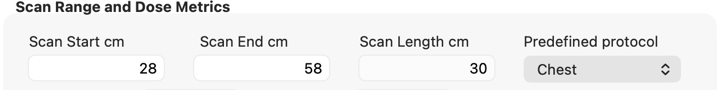

---

## 4. Dose output

NCICT reports organ absorbed dose (mGy) and effective dose (mSv). Results are intended for **comparative and population-level analyses**, not individual risk estimation.

Detailed cardiac substructure doses are available only for NCI size-dependent
phantoms. The pregnant phantoms do not contain separately tallied cardiac
substructures: the GUI hides these rows, and Batch output leaves the
corresponding cells blank. The reported Heart wall dose remains available and
is not copied into the unavailable substructure fields.

The GUI shows doses to three decimal places and positive doses below 0.001 as
`<0.001`. MC uncertainty is shown to two decimal places. Batch CSV and API
JSON retain numeric dose precision for subsequent calculations; MC uncertainty
is available only in the GUI.

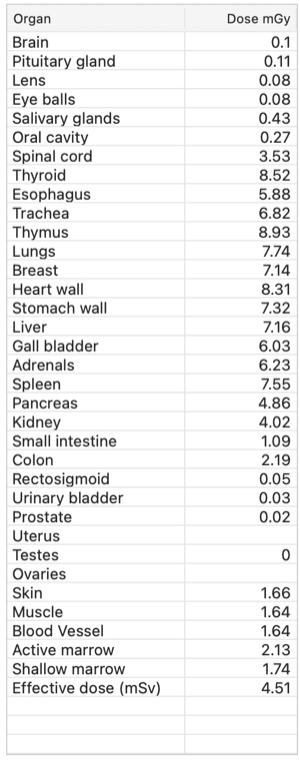

### 4.1 Monte Carlo statistical uncertainty

The **MC uncert %** column reports the relative Monte Carlo counting
uncertainty as one standard deviation. This is a statistical uncertainty from
the dose-coefficient simulations. It does not include uncertainty from patient
or phantom anatomy, scanner output, CTDI measurements, x-ray spectrum and
transport models, cross sections, or other systematic sources.

NCICT propagates the available slice-level relative uncertainties through
spectrum interpolation and sums independent slice variances in quadrature.
Dose uncertainty for active marrow and shallow marrow is first propagated from
the contributing skeletal-site and photon-energy fluence tallies using the
corresponding dose-response coefficients and marrow-distribution fractions.
Effective-dose uncertainty is propagated from the ICRP Publication 103
tissue-weighted dose components. MCNP covariance terms were not retained in
the dose library, so component tallies and source slices are treated as
independent in these calculations.

Dose coverage is the fraction of the displayed organ dose contributed by
slices for which finite MC uncertainty data are available; it is not the
fraction of slices. If `D_i` is a slice dose contribution and `r_i` its
relative MC uncertainty, the partial-data quantities are:

```text
dose coverage = sum(D_i with uncertainty) / sum(D_i from all slices)
reported relative uncertainty =
    sqrt(sum((D_i × r_i)^2 for slices with uncertainty)) / sum(D_i from all slices)
```

The displayed organ dose always includes all selected scan slices, including
slices without uncertainty data. Only unavailable variance terms are omitted.
The output uses a fixed 90% minimum dose-coverage quality threshold:

**Every numeric MC uncertainty reported by NCICT is calculated from uncertainty
data covering at least 90% of the displayed organ dose.**

- `9.42` means that at least 90% of the displayed dose has usable uncertainty
  data and the reported relative MC uncertainty is 9.42%. NCICT uses all
  available uncertainty data; it does not truncate a result at 90% coverage.
- `N/A` means dose coverage is below 90%, or no usable MC uncertainty is
  available. NCICT continues to show the library dose result; `N/A` applies
  only to the MC uncertainty column.

When coverage is between 90% and 100%, unavailable variance terms are omitted,
so the reported value may slightly underestimate the complete MC statistical
uncertainty. The 90% rule is intended as a practical reporting threshold for
communicating the statistical reliability of the dose estimate, not as a
complete uncertainty budget.

The 90% threshold is fixed so the same calculation is reported consistently
for all users and in repeated analyses; it is not a user-adjustable setting.

### Cardiac substructure acronyms

| Acronym    | Cardiac Substructure            |
| ---------- | ------------------------------- |
| H LA       | Left Atrium                     |
| H RA       | Right Atrium                    |
| H LV       | Left Ventricle                  |
| H RV       | Right Ventricle                 |
| H LVM      | Left Ventricular Myocardium     |
| H LMCA     | Left Main Coronary Artery       |
| H LADA     | Left Anterior Descending Artery |
| H LCA      | Left Circumflex Artery          |
| H RCA      | Right Coronary Artery           |
| H AV       | Aortic Valve                    |
| H MV       | Mitral Valve                    |
| H PV       | Pulmonary Valve                 |
| H TV       | Tricuspid Valve                 |

---

## 5. Batch calculation mode

Input parameters can be provided in CSV format. A template file (**ncictBatchInput.csv**) is included with the NCICT distribution and can be edited in Excel.

### 5.1 Workflow

1. Make a copy of **ncictBatchInput.csv**, keep the header row, and enter one
   examination per row.
2. In NCICT, click **Batch Calculation** and select the input CSV.
3. In the **Batch output** dialog, choose the output location and filename.
   The suggested name is **ncict_batch_output.csv**.
4. NCICT calculates all valid rows and reports the processed and skipped counts.
   The saved output contains the successfully processed rows.

Cardiac substructure columns remain in the fixed Batch output schema. For
fetus and mother calculations, these cells are blank because the pregnant
phantoms do not contain separately tallied cardiac substructures. A blank cell
means unavailable, not zero; Heart wall dose is still reported separately.

If a required header is missing, calculation stops with an error message. If
individual rows are skipped, the completion message shows the last row error.
Common row errors include an unknown profile ID, a profile that does not match
the submitted kVp or CTDI phantom, a partial `nctdic`/`nctdip` pair, or invalid
numeric values.

### 5.2 Input file and columns

Batch input accepts comma- or semicolon-delimited CSV files. Semicolon-delimited
CSV is recommended when decimal commas are used. In a comma-delimited file, a
value containing a decimal comma must be enclosed in double quotes. Saved Batch
CSV output always uses comma delimiters and dot decimals for consistent reuse
across regional settings.

Recommended Batch CSV column order:

```text
dose_target,age,sex,presentation,height,weight,wed,start,end,kvp,tcm_strength,head_body,ctdivol,ctdi_profile_id,nctdic,nctdip,protocol,custom_ma
```

The Batch parser reads column headers, so columns may be reordered as long as the required headers are present. Required headers are `dose_target`, `sex`, `kvp`, `tcm_strength`, `head_body`, and `ctdivol`, plus either `protocol` or both `start` and `end`. Each row must provide a protocol name or both boundaries. The `age` column is optional for patient-only files but is required when a row requests fetus or mother dose. The `sex` cell may be blank for fetus or mother dose. Additional empty columns may be placed after **custom_ma** to enter slice-specific custom mA values across Excel cells.

| Category | Column | Use |
| -------- | ------ | --- |
| Case identifier | `patientID` | Optional case identifier; rows are numbered if omitted |
| Phantom selection | `dose_target` | Required dose recipient: `patient`, `fetus`, or `mother` |
| Phantom selection | `age` | At least one required*: patient age in years; gestational age is always required for fetus or mother |
| Phantom selection | `sex` | Required for patient dose; `f`, `m`, `female`, and `male` are accepted; ignored for fetus or mother |
| Phantom selection | `presentation` | Optional `cephalic` or `breech`; defaults to `cephalic` and is ignored for patient dose |
| Phantom selection | `height` | At least one required*: patient height in cm; ignored for fetus and mother |
| Phantom selection | `weight` | At least one required*: patient weight in kg; ignored for fetus and mother |
| Phantom selection | `wed` | At least one required*: scan-average water-equivalent diameter in cm; leave blank when unavailable; ignored when height or weight is available and for fetus and mother |
| Scan range | `protocol` | Optional predefined protocol name with alias and minor-typo matching; overrides start/end |
| Scan range | `start`, `end` | Required when protocol is blank: distance from the top of the head in cm, or anatomical landmark IDs |
| Scanner parameters | `kvp` | Tube potential in kVp; must be greater than `0` |
| Scanner parameters | `tcm_strength` | `0` to `1`; leave blank when providing a custom mA profile |
| Scanner parameters | `head_body` | `1` = 16 cm head CTDI phantom; `2` = 32 cm body CTDI phantom |
| Scanner parameters | `ctdivol` | Required CTDIvol in mGy; must be greater than or equal to `0` |
| Scanner parameters | `ctdi_profile_id` | Optional exact profile ID for the submitted kVp and CTDI phantom |
| Scanner parameters | `nctdic`, `nctdip` | Optional center/peripheral CTDI in mGy/100 mAs; enter both as positive values |
| Scanner parameters | `custom_ma` | First custom mA value; required when `tcm_strength` is blank |

\* For patient dose, provide at least one of `age`, `height`, `weight`, or `wed`.

### 5.3 CTDI input modes

`ctdivol` remains the required absolute dose input in every mode.

| Mode | Input fields | Output `radial_mode` |
| ---- | ------------ | -------------------- |
| CTDIvol only | Leave `ctdi_profile_id`, `nctdic`, and `nctdip` blank | `ctdivol_only` |
| Built-in scanner profile | Enter the exact `ctdi_profile_id`; leave `nctdic` and `nctdip` blank | `scanner_library` |
| Explicit center/peripheral values | Enter positive `nctdic` and `nctdip` together; the ID is optional provenance | `explicit_cp` |

Profile IDs can be read from the GUI status line or from
**ncictCtdiProfiles.csv**. A profile ID must have data for the submitted `kvp`
and `head_body`. Explicit `nctdic` and `nctdip` values use mGy/100 mAs and take
priority when both an ID and a pair are present.

Profile components are linearly interpolated between available kVp values.
A supplied ID must still be recognized when an explicit pair is provided.
With no profile or pair, Batch applies no scanner-specific correction.

`p_over_c` is calculated internally from `nctdip/nctdic`; it is not an input
column. The included template contains examples of all three modes.

### 5.4 Patient and phantom matching

| Dose target | Available information                | Phantom selection                                        |
| ----------- | ------------------------------------ | -------------------------------------------------------- |
| Patient     | Height and weight                    | Closest size phantom                                     |
| Patient     | Height only                          | Estimate weight from closest sex-specific ICRP reference |
| Patient     | Weight only                          | Estimate height from closest sex-specific ICRP reference |
| Patient     | WED only                             | Phantom with the closest WED over the scan range         |
| Patient     | Age and sex only                     | Age- and sex-specific reference body size                |
| Patient     | Age unavailable, body size available | Infer the closest age/size group                         |
| Patient     | Age and body size unavailable        | Input error: provide age, height, weight, or WED          |
| Fetus       | Gestational age                      | Fetal phantom for the closest supported week             |
| Mother      | Gestational age                      | Maternal phantom for the closest supported week          |

Additional rules:

- Patient size priority: **height/weight → WED → age/sex reference**.
- For patient dose, at least one of `age`, `height`, `weight`, or `wed` is required.
- If WED and height/weight are both provided, WED is ignored.
- Gestational age is required for fetus and mother.
- Sex, height, weight, and WED are ignored for fetus and mother.
- If presentation is omitted, `cephalic` is used.

Patient Batch rows select NCI size-dependent phantoms. Reference body sizes
are matching targets; they do not select the GUI's ICRP voxel phantoms.
Patient age may be fractional, and `0` is valid for a newborn. Height, weight,
and WED must be positive to count as available body-size data.
For mother dose, the maternal library uses cephalic presentation, including
when `breech` is submitted.

Patient age below 20 years selects the pediatric candidate group; age 20 years or older selects the adult group. If age is omitted, NCICT searches the same-sex pediatric and adult candidates using the available body-size information. If age and body-size information are both omitted, the row is skipped with an input error.

For WED matching, NCICT calculates each candidate phantom's mean WED over the submitted scan range and selects the closest value. WED is supported for landmark-based and custom scan ranges and is not converted to body weight.

Supported gestational ages are 8, 10, 15, 20, 25, 30, 35, and 38 weeks. Other positive gestational ages are matched to the nearest supported week; ties select the lower week. Breech fetal phantoms are available at 10, 15, 20, and 25 weeks. For other weeks, cephalic presentation is used.

### 5.5 Protocol names, scan range, and landmarks

Scan-range priority is **protocol name → start/end**. A nonempty `protocol`
selects its predefined anatomical range and overrides both boundaries; the
`start` and `end` cells may be blank. Without a protocol, both boundaries
are required in cm or as landmark IDs.

Supported names match the GUI: `Head`, `Neck`, `Chest`, `Abdomen`, `Pelvis`,
`AP` (abdomen-pelvis), and `CAP` (chest-abdomen-pelvis). Matching ignores case,
spaces, common separators, and the words CT, scan, and protocol. Common aliases
include `brain`, `thorax`, `abdomen/pelvis`, and `abdominopelvic`; minor spelling
errors such as `chset CT` also match. Unknown or ambiguous names skip the row
with an error instead of falling back to its start/end values.

WED-based selection uses the resolved protocol range for each candidate
phantom. Output records the submitted name in `protocol`, the resolved name in
`matched_protocol`, and the final start/end in cm. Both name columns are blank
when only start/end were supplied.

| Output `protocol` | Output `matched_protocol` |
| ----------------- | ------------------------- |
| Chest             | Chest                     |
| chset CT          | Chest                     |
| abdomen/pelvis    | AP                        |
| CAP               | CAP                       |
Keep `protocol` before `custom_ma` so cells following `custom_ma` contain only
custom mA samples.

Scan start and end locations can be specified either as distances from the top of the head in cm or as anatomical landmark IDs. If a landmark ID is used for one boundary, a landmark ID should also be used for the other boundary.

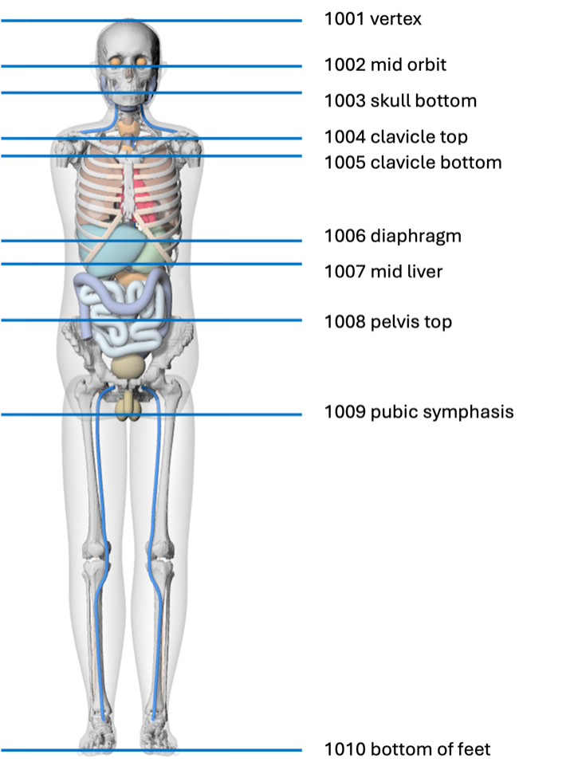

Common protocol ranges can be entered using the following landmark ID pairs:

| Protocol             | Start landmark ID | End landmark ID |
| -------------------- | ----------------- | --------------- |
| Head                 | 1001              | 1003            |
| Neck                 | 1002              | 1005            |
| Chest                | 1004              | 1007            |
| Abdomen              | 1006              | 1008            |
| Pelvis               | 1008              | 1009            |
| Abdomen-pelvis       | 1006              | 1009            |
| Chest-abdomen-pelvis | 1004              | 1009            |

Other valid landmark pairs, including `1001` to `1010`, may be entered directly for customized scan ranges.

After landmark conversion, the scan range must satisfy `0 <= start < end <= 190`.

### 5.6 Custom mA profiles

When editing the Batch CSV in Excel, custom mA values can be entered across multiple cells starting at the **custom_ma** column:

| dose_target | age | sex | presentation | height | weight | wed | start | end | kvp | tcm_strength | head_body | ctdivol | custom_ma |     |     |     |     |     |     |
| ----------- | --- | --- | ------------ | ------ | ------ | --- | ----- | --- | --- | ------------ | --------- | ------- | --------- | --- | --- | --- | --- | --- | --- |
| patient     | 10  | f   |              |        |        | 25  | 0     | 20  | 120 |              | 1         | 20      | 100       | 200 | 300 | 400 | 500 | 600 | 700 |

Enter each custom mA value in its own Excel cell rather than as an array with
brackets. NCICT reads the **custom_ma** cell and all numeric cells to its right
as a single custom mA profile. The delimiter and decimal-separator rules in
Section 5.2 also apply. Leave these cells blank when a numeric `tcm_strength`
from `0` to `1` is used.

### 5.7 Examples and output

The included test template has 38 cases: 33 expected successes, one intentional
missing-patient-information failure, and four protocol-matching failures
(`Whole body`, `Cardiac`, `Chest abdomen`, and `xyz`). Running it should report
33 processed and five skipped rows. Remove
the intentional failure rows when using the template for routine calculations.

Protocol names can replace start/end entirely:

```csv
dose_target,age,sex,protocol,kvp,tcm_strength,head_body,ctdivol
patient,40,m,Chest CT,120,0,2,10
mother,20wk,,abdomen/pelvis,120,0,2,10
```

These rows show CTDIvol-only, built-in profile, explicit c/p, fetus, and custom
mA cases:

```csv
dose_target,age,sex,presentation,height,weight,wed,start,end,kvp,tcm_strength,head_body,ctdivol,ctdi_profile_id,nctdic,nctdip,custom_ma,,,,,,
patient,10,f,,,,,0,20,120,0,1,20,,,,
patient,20,m,,175,80,,0,20,120,0,2,20,CTDI-07-002-02,,,
patient,20,m,,175,80,,0,20,120,0,2,20,,3.84,6.98,
fetus,38wk,,,,,,1004,1009,120,0,2,20,,,,
patient,10,f,,,,25,0,20,120,,1,20,,,,100,200,300,400,500,600,700
```

Output CSV includes:

- Patient ID and dose target
- Age, sex, presentation, height, weight, WED, and scan start/end
- Scanner parameters
- Radial mode, profile ID, resolved nCTDIc/nCTDIp, p/c ratio, and CTDI library version
- Matched phantom group and matched phantom size or fetal age
- Submitted `protocol` and resolved `matched_protocol`, with final scan start/end in cm
- Organ doses and effective dose

The output order is `phantom_group`, `matched_height_cm`,
`matched_weight_kg`, `matched_fetal_age_weeks`, `protocol`,
`matched_protocol`, followed by organ doses. Dose values retain calculated
numeric precision; format these columns in Excel for the desired display.

When WED is not provided, its output CSV cell is left blank; the internal
missing-value marker is never written to the user-facing file.
WED is also blank when ignored because height/weight or a pregnant dose target
was supplied.
For a custom mA profile, the `tcm_strength` output cell is also left blank.
